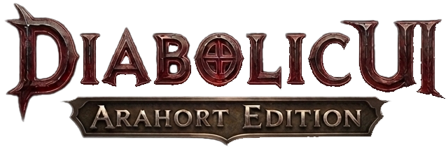

  

# Diabolic UI — Forever

An orb-based graphical interface for **World of Warcraft: Forever**, with Diablo-inspired artwork and modern native UI integration.

**First public build: `6.6.6-r1`, an alpha prerelease for Forever `1.60.1` (build `70862`, Interface `16001`).** Combat behavior, group transitions and class-specific controls still need wider testing. This release does not claim complete compatibility with other client builds.

## About this fork

This project adapts [Diabolic UI — Arahort Edition](https://github.com/Arahort/diabolic) to Forever. It builds on the original [Diabolic UI](https://github.com/GoldpawsStuff/DiabolicUI) by Lars "Goldpaw" Norberg.

Forever uses modern UI APIs despite its `1.60.1` version number. This edition uses native duration, aura and health-prediction APIs, and retains native gameplay controls where a custom replacement has not been validated.

## Features

- Diablo-style health and resource orbs, with optional 3D models, a visual model picker and animation-speed controls.
- Incoming-heal, absorb and heal-absorb displays built around native prediction data.
- Custom action bars, hidden-bar hotkeys and native cooldown integration.
- A styled native player castbar with cast/channel time and a separate Edit Mode mover.
- Custom unit frames and native aura containers; player debuffs have an independent Edit Mode mover.
- A minimap XP/rested ring that starts at the top and fills clockwise. Thickness and transparency update live from the **Minimap Edit Mode window**.
- Minimap coordinates, group-finder integration and an addon-button collector.
- A custom MicroMenu presentation around native buttons, tooltip customization and a matching game-menu skin.
- Native Settings integration and translations for all 12 supported locales.

Native pet controls, stances/forms, totem controls, raid frames and other status bars remain available where the addon uses native fallbacks. The minimap ring replaces the XP bar's presentation while reputation and other status bars are preserved.

3D model availability depends on the Forever client. A model listed in the picker may not be available in this client build.

## Requirements

- **WoW Forever `1.60.1` (build `70862`).**
- Bundled libraries are included; a separate Ace3 or oUF installation is not required.
- Optional: LibSharedMedia for additional fonts; BugGrabber/BugSack for error reports.

## Installation

1. Download **`DiabolicUI3-Forever.zip`** from [GitHub Releases](https://github.com/Arahort/diabolic-forever/releases).
2. Close Forever and extract the `DiabolicUI3` folder into `_forever_/Interface/AddOns/`.
3. Confirm that `_forever_/Interface/AddOns/DiabolicUI3/DiabolicUI3.toc` exists. Avoid an extra nested archive folder.
4. Start Forever, enable the addon and open **Settings → AddOns → Diabolic UI**.
5. Use **Edit Mode** to move supported elements. Select the minimap there to adjust its XP ring.

Keep the addon folder named **`DiabolicUI3`**: artwork paths and saved settings use that name. Back up existing Forever settings before replacing an earlier test build. Do not copy another client's SavedVariables into Forever automatically.

## Alpha status and known issues

- Secret-value comparison errors can still surface in Blizzard's Damage Meter while this addon is enabled. Investigation is ongoing; this build does not claim to fix them.
- Combat joins/leaves, pet and form transitions, totem controls, aura updates and individual 3D models need further in-game testing.
- Native UI or other addons can affect shared library selection and layout behavior. Include your addon list when reporting a problem.

See [TESTING.md](TESTING.md) for checks and diagnostic commands. Static checks and controlled Lua tests do not replace testing in the actual client.

## Reporting issues

Use [GitHub Issues](https://github.com/Arahort/diabolic-forever/issues). Include the addon version, exact client build, steps to reproduce, combat state, screenshots and the full error stack when available.

Bounded diagnostics are enabled in this alpha. `/diabolicforever snapshot` captures additional state; `/diabolicforever stop` stops recording. Records are written to SavedVariables on `/reload` or normal logout. [Diagnostic instructions](TESTING.md#diagnostics) explain where to find them.

## Credits and licenses

- **Original Diabolic UI code and artwork:** Lars "Goldpaw" Norberg; original custom license, all rights reserved.
- **Forever adaptation and maintenance:** Alex Arahort — [arahort.pro](https://arahort.pro), [alex@arahort.pro](mailto:alex@arahort.pro).
- **Artwork:** Alex Arahort and [Karina Kisenkova](https://www.behance.net/kisenkova).
- **3D orb engine:** oUF_Diablo / rModelOrbTemplate by zork (Erik Raetz), MIT License.
- **Game-menu skin:** artwork and original implementation by Gonkast, MyCustomFrames "Charcoal", used with permission.
- **Embedded libraries:** their respective authors; original licenses and notices are retained with the source files.

This fork does not replace the original project's or third-party components' licenses with a blanket license.

## Support the developer

- [Patreon](https://www.patreon.com/c/Arahort)
- [Boosty](https://boosty.to/alex_arahort)
- [Discord](https://discord.com/channels/407765646634385408/1478671797695025272)

## Changelog

See [CHANGELOG.md](CHANGELOG.md) for the consolidated first-public-build changes.
